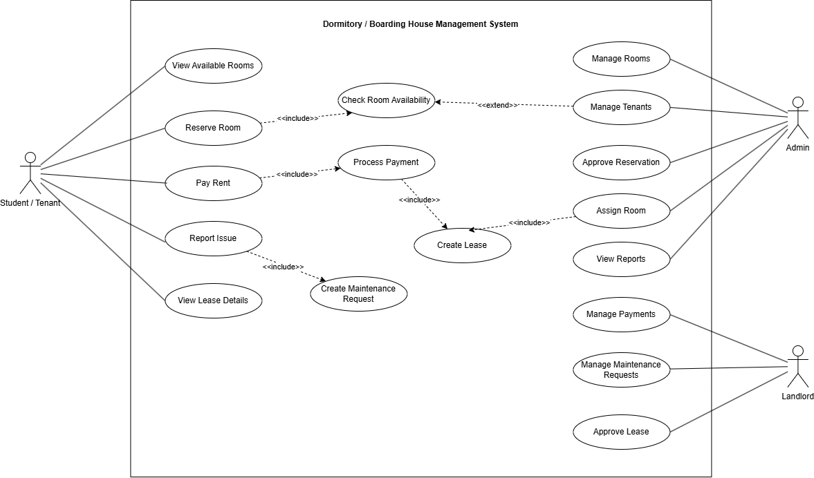
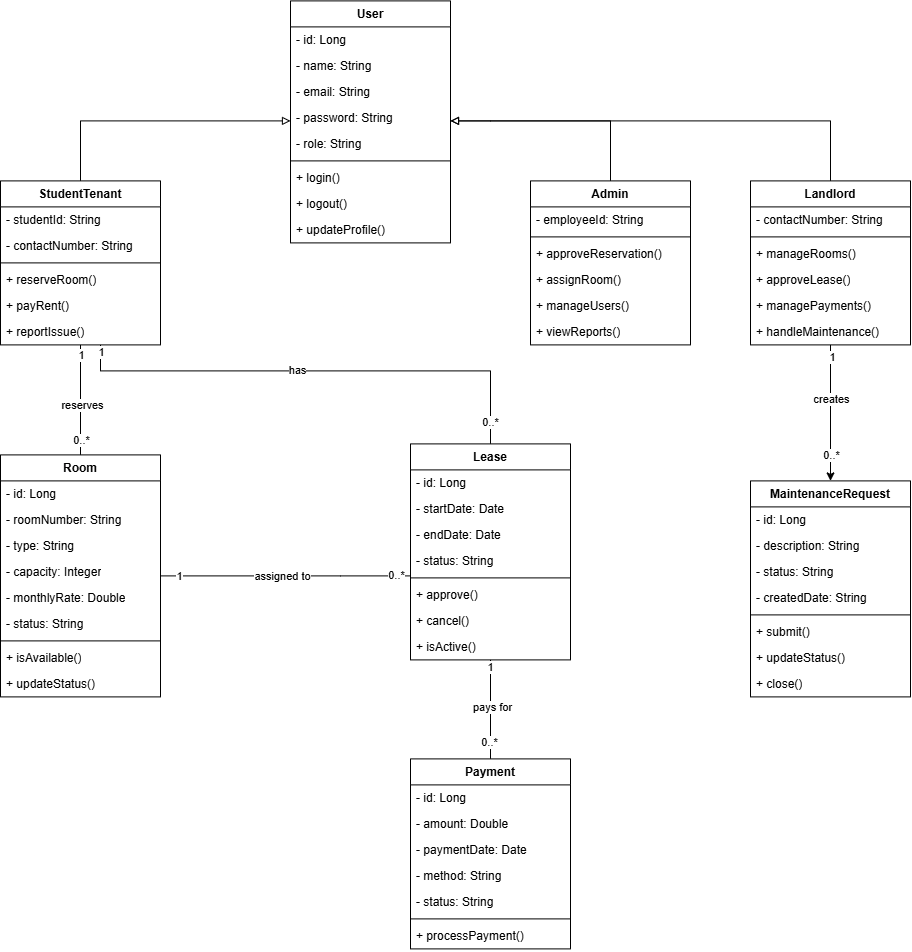
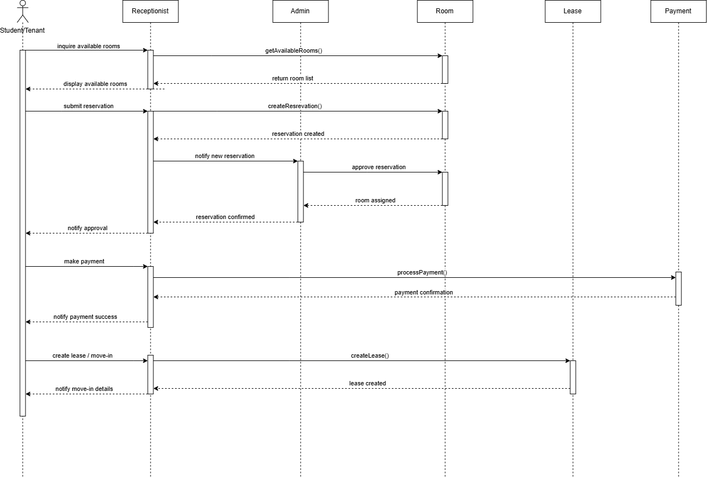
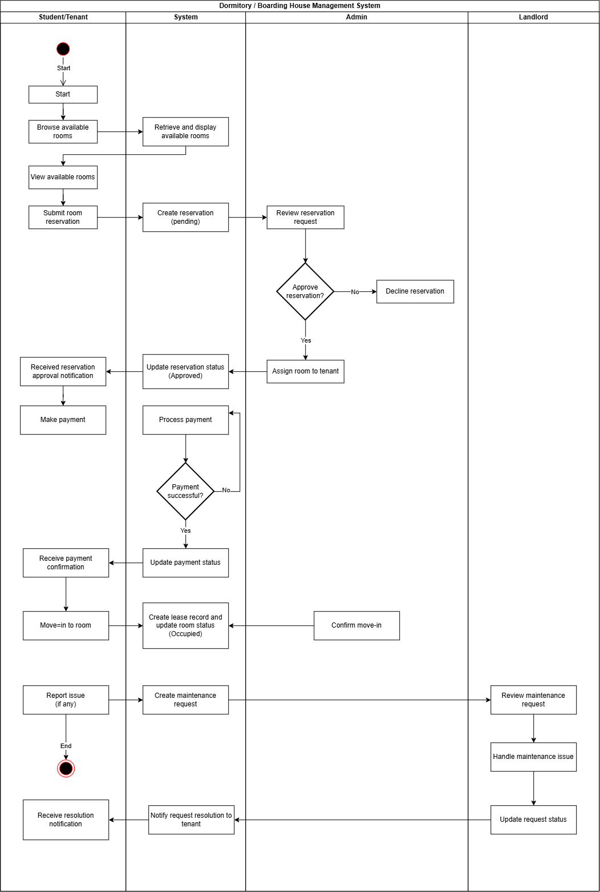

# Dormitory / Boarding House Management System

## Project Description

The Dormitory / Boarding House Management System is a web-based application designed to help manage common dormitory and boarding house operations in a more organized and efficient way.

The system focuses on managing tenants, rooms, room reservations, leases, rental payments, and maintenance requests. It provides a centralized platform where tenants can reserve available rooms, monitor their reservation and lease information, make rental payments, and report room-related issues.

Administrators are responsible for reviewing reservations, assigning rooms, managing tenants, and monitoring system records. Landlords can manage rooms, payments, leases, and maintenance-related concerns.

The project is currently being developed using Spring Boot for the backend and MySQL for data storage. A React + Vite frontend is planned for the next development phase.

### Target Users / Stakeholders

The primary users of the system are:

- **Student / Tenant** – reserves rooms, pays rent, views lease information, and submits maintenance requests.
- **Admin** – manages tenants, reviews and approves reservations, assigns rooms, and monitors system records.
- **Landlord** – manages rooms, lease records, payments, and maintenance requests.

---

## Objectives

The main objectives of the Dormitory / Boarding House Management System are:

- To simplify the room reservation and approval process.
- To maintain organized records of tenants and available rooms.
- To manage room assignments and lease information efficiently.
- To record and monitor rental payments.
- To provide tenants with a convenient way to report maintenance issues.
- To help administrators and landlords monitor dormitory operations through a centralized system.
- To apply object-oriented programming principles in the design and implementation of the system.

---

## Key Features

The system includes the following major features:

### User Management
Manages system users including tenants, administrators, and landlords.

### Room Management
Allows rooms to be added, updated, viewed, and monitored based on availability, capacity, and occupancy status.

### Room Reservation
Allows tenants to select and reserve available rooms.

### Reservation Approval
Allows administrators to review, approve, reject, or cancel room reservation requests.

### Room Assignment
Assigns an approved tenant to the selected room.

### Lease Management
Stores lease information including the tenant, assigned room, rental rate, start date, end date, and lease status.

### Payment Management
Records rental payments associated with a tenant's lease and tracks payment status.

### Maintenance Request Management
Allows tenants to report room-related issues and enables the landlord or administrator to track the progress of maintenance requests.

---

## Technology Stack

### Backend
- Java
- Spring Boot
- Spring Web
- Spring Data JPA
- Hibernate
- Jakarta Persistence API

### Database
- MySQL

### Build Tool
- Maven

### API Testing
- Postman

### Frontend
- React
- TypeScript
- Vite

> Frontend development is planned for the next phase of the project.

### Development Tools
- IntelliJ IDEA
- MySQL Workbench
- Git
- GitHub

## UML Diagrams

The following UML diagrams represent the design, structure, and major workflows of the Dormitory / Boarding House Management System.

### Use Case Diagram

The Use Case Diagram identifies the major actors of the system, including the Student/Tenant, Admin, and Landlord, and shows their interactions with the primary system functions.



### Class Diagram

The Class Diagram represents the major classes of the system, their attributes and methods, and the relationships between the main components of the application.



### Sequence Diagram

The Sequence Diagram illustrates the interaction between the Student/Tenant, system components, administrator, room, lease, and payment processes during the room reservation and move-in workflow.



### Activity Diagram

The Activity Diagram illustrates the overall workflow of the system, including room browsing, reservation, approval, payment, move-in, and maintenance request handling.



---

## Project Structure

```text
dormitory-management/
│
├── docs/
│   └── uml/
│       ├── use-case-diagram.png
│       ├── class-diagram.png
│       ├── sequence-diagram.png
│       └── activity-diagram.png
│
├── src/
│   ├── main/
│   │   ├── java/
│   │   │   └── com/dormisync/dormitory_management/
│   │   │       ├── controller/
│   │   │       ├── dto/
│   │   │       ├── entity/
│   │   │       ├── enums/
│   │   │       ├── repository/
│   │   │       ├── service/
│   │   │       └── DormitoryManagementApplication.java
│   │   │
│   │   └── resources/
│   │       └── application.properties
│   │
│   └── test/
│
├── .gitignore
├── pom.xml
├── mvnw
├── mvnw.cmd
└── README.md


